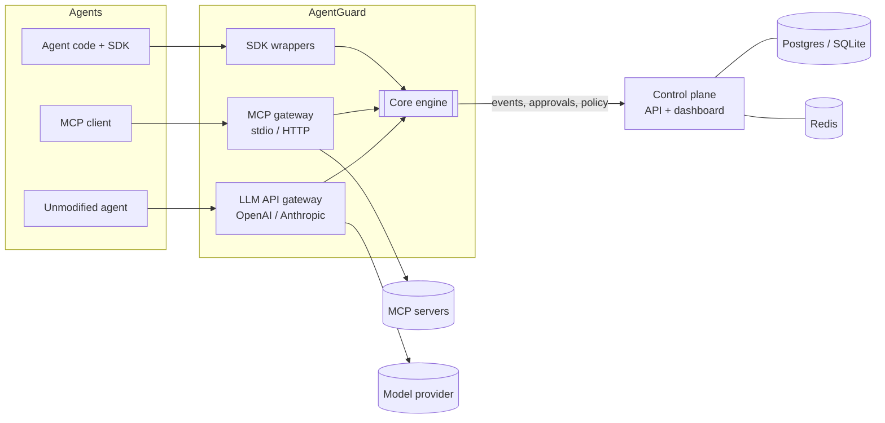
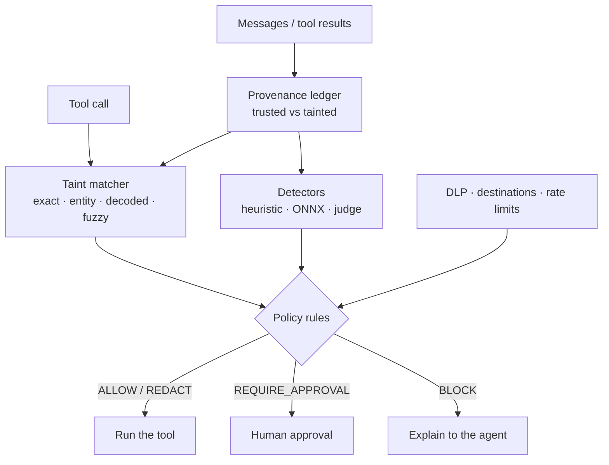

# Architecture



## The engine pipeline



## Design decisions

| Decision | Choice | Why |
|---|---|---|
| Provenance source of truth | Rebuilt from the message list on every LLM call | Chat APIs resend the conversation, so the LLM gateway is stateless and cannot mix tenants' context |
| "Derived from taint" | Value appears in tainted content and **not** in trusted content | Separates "the user asked me to email bob@corp.com" from "a web page told me to email evil@x" |
| MCP gateway | JSON-RPC message proxy | Transparent to protocol versions and capabilities it does not need to understand |
| ML runtime | ONNX + int8, no torch at inference | Small image, CPU-only, predictable latency |
| Dashboard | Server-rendered Jinja + vendored HTMX | One deployable; strict CSP with no inline scripts or styles |
| Open core | `ee/` loaded via the `agentguard.plugins` entry point | Clean license boundary; the core works without it |

## Packages

```text
src/agentguard/
  core/        engine, provenance, taint, policy, detectors, DLP, approvals, events
  adapters/    OpenAI chat / Responses and Anthropic Messages wire formats
  sdk/         client wrappers and framework integrations
  gateway/     mcp/ (stdio, http), llm/ (OpenAI/Anthropic compatible)
  server/      control plane: API, auth, audit, dashboard, migrations
ee/agentguard_ee/   OIDC, multi-org, SIEM, Slack (commercial license)
ml/                 training pipeline and evaluation reports
```
