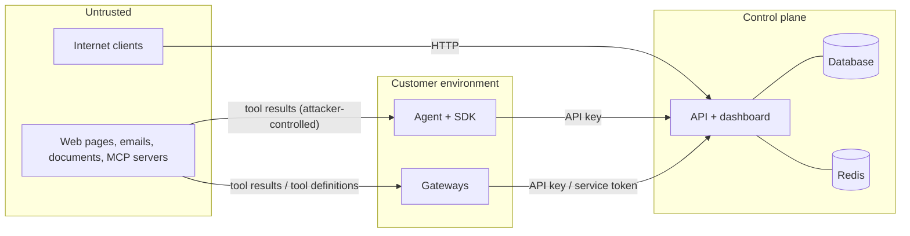

# Threat model (STRIDE)

This models threats to **AgentGuard itself**. The attacks AgentGuard defends agents against are
described in [Provenance and taint](../concepts/provenance.md) and [Limitations](../limitations.md).

## System and trust boundaries

| # | Boundary | What crosses it |
|---|---|---|
| B1 | tool output → engine | attacker-controlled text, tool definitions |
| B2 | agent/gateway → control plane | events (which may contain user data), approvals, policy fetch |
| B3 | browser → dashboard | sessions, policy edits, approval decisions |
| B4 | control plane → outbound | webhooks, Slack, SIEM, LLM judge |
| B5 | tenant ↔ tenant | everything in the multi-tenant control plane and gateways |

## Assets

Policies (they define what agents may do), approval decisions, API keys and sessions, event data
(arguments can contain personal data), the audit log, provider credentials passing through the
LLM gateway, and the integrity of enforcement decisions.

## Threats and mitigations

### Spoofing

| Threat | Mitigation |
|---|---|
| Forged API key or stolen session | 40-char random keys stored as SHA-256 hashes; scoped keys; revocation and expiry; session tokens stored hashed, `HttpOnly`, `SameSite=Strict`, `Secure` in production, server-side expiry |
| Credential stuffing on login | per IP+email rate limit; scrypt (N=2¹⁵) password hashes; constant work for unknown users |
| Forged approval via webhook | single-purpose HMAC-SHA256 tokens bound to one approval and decision, 7-day expiry, single use (status must be pending) |
| Forged Slack interaction | Slack v0 signature check with 5-minute replay window; only allow-listed Slack user IDs can decide |
| Forged OIDC login | Authorization Code + PKCE (S256), `state` and `nonce` in a signed short-lived cookie, ID-token signature verified against JWKS, `iss`/`aud`/`exp`/`nonce` checked, optional email-domain allow list |
| Gateway accepting any client | gateways require `X-AgentGuard-Key` (static hashed keys or control-plane introspection); `auth.mode: none` must be set explicitly and logs a warning |

### Tampering

| Threat | Mitigation |
|---|---|
| Injection in tool output steering the agent | the product's purpose: taint tracking, detectors, policy; tool output is never executed or evaluated by AgentGuard |
| Poisoned or changed MCP tool definitions | description scanning; per-tool definition hashes pinned on first sight; changes quarantined |
| Prompt injection against the LLM judge | judge input fences untrusted text; the judge can only add a block, never allow |
| Malicious policy edit | admin-only; every revision versioned with digest, author and note; audit-logged |
| Audit-log tampering | per-org hash chain (`sha256(prev ‖ canonical entry)`) with sequence numbers; `/audit/verify` detects edits, deletions and reordering; export the head hash to detect truncation |
| CSRF on dashboard actions | per-session CSRF token required on every state-changing cookie-authenticated request; login form has its own double-submit token; `SameSite=Strict` |
| XSS through event data (attacker-controlled tool arguments) | Jinja auto-escaping everywhere; CSP `script-src 'self'` and `style-src 'self'` with no inline scripts or styles; HTMX `allowEval`/`allowScriptTags` disabled |
| SQL injection | SQLAlchemy parameterized queries only |
| Regex DoS through policy patterns | policy regexes limited to 512 chars and admin-only (residual risk below) |

### Repudiation

Approvals, policy changes, key creation/revocation, membership changes, logins and false-positive
reports are written to the hash-chained audit log with actor, channel and time. Events carry the
policy name and revision that produced each decision.

### Information disclosure

| Threat | Mitigation |
|---|---|
| Secrets in events/logs | DLP masking in the SDK before events leave the process, again on ingest; strings truncated; provider credentials forwarded but never logged |
| Cross-tenant access | every row carries `org_id`; every query filters on the principal's org; foreign IDs return 404; event IDs cannot be overwritten across orgs; payload `tenant_id` is ignored; gateway sessions keyed by (tenant, server, session) |
| Data leaving via the judge | judge is off by default; when on, only truncated untrusted snippets, the user task and the call are sent to the configured provider |
| Verbose errors | generic 500 responses; OpenAPI docs disabled in production; `no-store` on API responses |

### Denial of service

Request body limits (12 MB server, 32 MB LLM gateway, 8 MB MCP HTTP), event batch limits, API rate
limits per key/IP (Redis-backed across replicas), bounded caches and queues (the SDK event queue
drops oldest events rather than blocking the agent), timeouts on upstream and judge calls.

### Elevation of privilege

| Threat | Mitigation |
|---|---|
| Role or scope escalation | permission matrix enforced per route; API keys cannot mint keys with scopes they lack; the last admin cannot be demoted or removed |
| Container breakout impact | non-root UID 10001, read-only root filesystem, all capabilities dropped, `no-new-privileges`, seccomp `RuntimeDefault`, no service-account token |
| Engine failure leading to "allow" | `fail_mode: closed` by default; even with `open`, tools above `fail_open_max_risk` fail closed |

## Residual risks

- **Detection is probabilistic.** Novel phrasings, split payloads and paraphrases can evade
  detectors and taint matching.
- **MCP gateway without user context** cannot distinguish user-requested values from tool-supplied
  ones unless the client passes the prompt.
- **Python `re` has no timeouts.** A malicious admin could add a catastrophic-backtracking regex to a
  policy. Mitigated by length limits and admin-only access; RE2 support is a planned improvement.
- **Redis outage** makes API rate limiting fail open (by design, to keep the API available); policy
  rate limits in the engine use the in-memory limiter or `fail_open=False`.
- **The heuristic rules are public.** Attackers can read them; the ML layer and taint tracking do not
  depend on secrecy.
- The SQLite mode is single-user and has no encryption at rest; use Postgres with encrypted storage
  for production.
